# ER diagram

Mermaid `erDiagram` of every table in `db/migrations/002–005`. Crow's-foot notation:
`||--o{` is one-to-many, `||--o|` is one-to-zero-or-one (supertype → subtype), `}o--o{` would be many-to-many
(none appear directly: every M:N is resolved by a junction table).

```mermaid
erDiagram
    users ||--o{ project_members : "holds role in"
    roles ||--o{ project_members : "assigned as"
    projects ||--o{ project_members : "has member"
    roles ||--o{ roles : "inherits (parent_role_id)"
    roles ||--o{ role_permissions : grants
    permissions ||--o{ role_permissions : "granted by"
    users ||--o{ api_keys : owns
    users ||--o{ projects : owns
    projects ||--o{ projects : "parent_project_id"

    projects ||--o{ quotas : limits
    resource_types ||--o{ quotas : "limited type"
    projects ||--o{ resources : contains
    resource_types ||--o{ resources : "typed as"
    nodes ||--o{ resources : "runs on"

    resources ||--o| compute_instances : "is a (type 1)"
    resources ||--o| storage_volumes : "is a (type 2)"
    resources ||--o| networks : "is a (type 3)"
    compute_instances ||--o{ network_attachments : "attached via"
    networks ||--o{ network_attachments : "has address"

    resource_types ||--o{ pricing_plans : "priced by"
    resources ||--o{ allocations : "billed during"
    projects ||--o{ allocations : "pays for"
    resources ||--o{ usage_metrics : emits
    resources ||--o{ usage_rollup_daily : "summarised in"
    resources ||--o{ log_entries : logs

    billing_cycles ||--o{ invoices : covers
    projects ||--o{ invoices : "billed to"
    invoices ||--|{ invoice_line_items : "weak entity of"
    resources ||--o{ invoice_line_items : "charged for"
    invoices ||--o{ payments : "settled by"
    billing_cycles ||--o{ billing_failures : "failed in"
    projects ||--o{ billing_failures : "failed for"

    projects ||--o{ alert_rules : defines
    alert_rules ||--o{ alert_events : fires
    resources ||--o{ alert_events : "raised on"

    users {
        int user_id PK
        text email UK
        text name
        text status
        text password_hash "bcrypt via pgcrypto"
        timestamptz created_at
        timestamptz updated_at
    }
    roles {
        int role_id PK
        text name UK
        int parent_role_id FK
    }
    permissions {
        int perm_id PK
        text action
        text resource_type "UNIQUE(action, resource_type)"
    }
    role_permissions {
        int role_id PK
        int perm_id PK
    }
    project_members {
        int project_id PK
        int user_id PK
        int role_id FK "ternary relationship"
    }
    api_keys {
        int key_id PK
        int user_id FK
        text key_hash
        timestamptz revoked_at
    }
    projects {
        int project_id PK
        text name UK
        int owner_id FK
        int parent_project_id FK
    }
    quotas {
        int project_id PK
        int resource_type_id PK
        int max_units "CHECK >= 0"
    }
    nodes {
        int node_id PK
        text hostname UK
        text region
    }
    resource_types {
        int type_id PK
        text name UK
        text unit
    }
    resources {
        int resource_id PK
        int project_id FK "ON DELETE RESTRICT"
        int type_id FK
        int node_id FK
        text name
        text external_id UK "docker id"
        text state "pending running stopped terminated"
        text source "discovered provisioned"
    }
    compute_instances {
        int resource_id PK
        int type_id "pinned to 1"
        int vcpus
        int memory_mb
        text image
    }
    storage_volumes {
        int resource_id PK
        int type_id "pinned to 2"
        int size_gb "CHECK > 0"
        text mount_path
    }
    networks {
        int resource_id PK
        int type_id "pinned to 3"
        cidr cidr
    }
    network_attachments {
        int resource_id PK
        int network_id PK
        inet ip "UNIQUE(network_id, ip)"
    }
    pricing_plans {
        int plan_id PK
        int type_id FK
        numeric unit_price
        timestamptz effective_from
        timestamptz effective_to "EXCLUDE gist no overlap per type"
    }
    allocations {
        int allocation_id PK
        int resource_id FK
        int project_id FK
        tstzrange period "EXCLUDE gist no overlap per resource"
    }
    usage_metrics {
        int resource_id PK
        text metric PK
        timestamptz ts PK "PARTITION BY RANGE monthly"
        float value
    }
    usage_rollup_daily {
        int resource_id PK
        date day PK
        text metric PK
        float avg_value
        int samples
    }
    log_entries {
        bigint log_id PK
        timestamptz ts PK "PARTITION BY RANGE monthly"
        int resource_id FK
        text level
        text message
        jsonb attrs
    }
    billing_cycles {
        int cycle_id PK
        tstzrange period "EXCLUDE gist"
    }
    invoices {
        int invoice_id PK
        int project_id FK "UNIQUE(project_id, cycle_id)"
        int cycle_id FK
        numeric total
        text status
    }
    invoice_line_items {
        int invoice_id PK
        int line_no PK
        int resource_id FK
        numeric units
        numeric unit_price "frozen on purpose"
        numeric amount
    }
    payments {
        int payment_id PK
        int invoice_id FK
        numeric amount
        timestamptz paid_at
    }
    billing_failures {
        int failure_id PK
        int cycle_id FK
        int project_id FK
        text sqlstate
        text message
    }
    alert_rules {
        int rule_id PK
        int project_id FK
        text metric
        text operator
        float threshold
        int window_seconds
    }
    alert_events {
        int event_id PK
        int rule_id FK
        int resource_id FK
        timestamptz fired_at
        timestamptz resolved_at
        float peak_value
    }
    audit_log {
        bigint audit_id PK
        int actor_id "no FK: audit outlives users"
        text table_name
        text op
        text row_pk
        jsonb old_data
        jsonb new_data
    }
```

## Reading the diagram

| Modelling concept | Where it appears |
|---|---|
| Recursive (unary) relationships | `roles.parent_role_id` (role hierarchy), `projects.parent_project_id` (project tree) |
| Ternary relationship | `project_members(project_id, user_id, role_id)`: a user holds *one role in one project* |
| M:N resolved by a junction table | `role_permissions` (roles ↔ permissions), `network_attachments` (VMs ↔ networks) |
| Supertype / subtype (disjoint + total) | `resources` → `compute_instances` / `storage_volumes` / `networks` |
| Weak entity | `invoice_line_items` (identified by `(invoice_id, line_no)`, `ON DELETE CASCADE`) |
| Temporal data | `pricing_plans`, `allocations`, `billing_cycles` use range types with `EXCLUDE` constraints |
| Partitioned tables | `usage_metrics`, `log_entries` (monthly `RANGE (ts)`) |
| Derived / summary data | `usage_rollup_daily` (table), `mv_daily_usage` (materialized view) |
| Intentionally unlinked | `audit_log.actor_id` has no foreign key so history survives user deletion |

Views (not drawn): `v_active_resources`, `v_project_cost_mtd`, `v_open_alerts`, `v_user_effective_permissions`,
`mv_daily_usage` and the supporting `v_*` views in `db/migrations/011_views_jobs.sql`.
